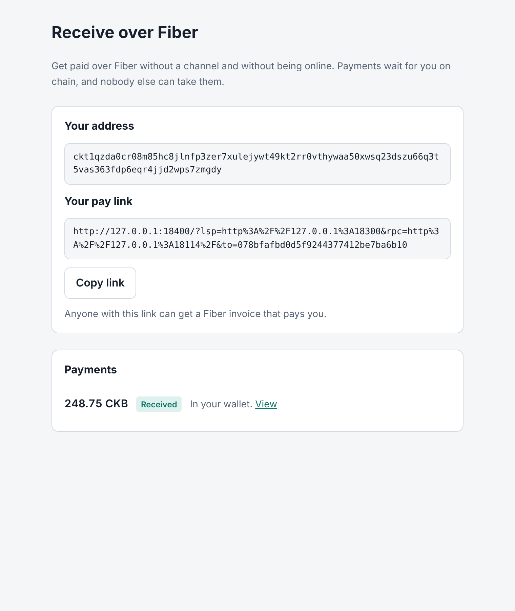

# Fiber Claim Cell

An on-chain claim module for LSPs (liquidity service providers) on CKB's [Fiber Network](https://github.com/nervosnetwork/fiber). When a receiver has no channel, not enough inbound capacity, or no CKB, the LSP locks the payment in an L1 cell that only the receiver can claim. The LSP never takes custody.

The receiver is meant to need no new wallet: they open a web page, connect the wallet they already have, and sign one message. So for this to reach users, only an LSP has to opt in. The limits of that claim today are listed under [Receive web app](#receive-web-app).

This project is not an LSP. Opening channels, providing liquidity and hosting nodes are done by Fiber's own hosted LSP and by operators such as Cellula. What is here is a part they can adopt: a lock script, a specification, and reference implementations of the LSP side and the wallet side.

What exists so far: a draft of RFC 0001, its L1 lock script implemented and verified on testnet, a reference implementation of the LSP-side module, and a receive web app. The reference implementation has run the full flow on three real Fiber nodes and the CKB testnet.

## RFC

| No. | Title | Status |
| --- | --- | --- |
| [0001](rfcs/0001-async-receive.md) | Async receive on Fiber (hold and wake, with an on-chain claim fallback) | Draft |

## Layout

| Path | Contents |
| --- | --- |
| `rfcs/` | Specification |
| `docs/proposal.md` | Draft proposal for the CKB Community Fund DAO (not yet submitted) |
| `docs/review-notes.md` | Findings of the internal reviews and what was done about each |
| `contracts/async-claim-lock/` | The claim cell lock script of RFC 0001 (Rust, `no_std`) |
| `tests/` | Script-level tests, run in the CKB-VM verifier of ckb-testtool |
| `e2e/` | On-chain verification of the lock script on testnet: scripts, deployment info and report |
| `app/` | Receive web app: receive with an existing wallet, with no change to the wallet |
| `lsp/` | Reference implementation of the LSP-side module, the receiver's verification logic, and the Fiber end-to-end tests |

## Build and test

Rust and the `riscv64imac-unknown-none-elf` target are required:

```bash
rustup target add riscv64imac-unknown-none-elf
```

```bash
make test
```

`make test` builds the contract to `build/release/async-claim-lock` and then runs the 33 script-level tests. The toolchain version is pinned in `contracts/async-claim-lock/rust-toolchain.toml`, and the build is reproducible.

## Testnet verification

```bash
cd e2e && npm install
```

```bash
TESTNET_PRIVATE_KEY=0x... npm run testnet
```

The key's address needs testnet CKB: about 18,500 CKB on the first run, which deploys the binary, and under 1,000 CKB on each later run. The script submits the transactions that must be rejected straight to a node and records the reason for each rejection, submits the ones that must pass and waits for them to confirm, and writes the result to `e2e/testnet-report.json`.

Current testnet deployment:

| Field | Value |
| --- | --- |
| Deployment transaction | [`0xb367c3c1a9b840df3c4ea5838ec2190a1a6a16f61da9961912c38d5dd520e186`](https://testnet.explorer.nervos.org/transaction/0xb367c3c1a9b840df3c4ea5838ec2190a1a6a16f61da9961912c38d5dd520e186) |
| Output index | 0 |
| code hash | `0x8db24f4dc53d59e572397ee60c9fb1783f7a15cb22908b85ce329edca71de623` |
| hash type | `data2` |

## Fiber end-to-end tests

These need an `fnn` binary (the Fiber node, built from the [nervosnetwork/fiber](https://github.com/nervosnetwork/fiber) source with `cargo build --release -p fiber-bin`) and its testnet config template:

```bash
cd lsp && npm install
```

```bash
TESTNET_PRIVATE_KEY=0x... FNN_BIN=/path/to/fnn FNN_CONFIG_TEMPLATE=/path/to/fiber/config/testnet/config.yml npm run e2e
```

The script starts three nodes on the local machine (payer, LSP, receiver), opens two channels on testnet, and runs four scenarios in turn: receiving over the channel; claiming on L1 after being offline; a refund when nobody claims; and an LSP that crashes while sending a claim cell, restarts, and is then down at expiry, so that an independent watcher refunds the cell. The first run funds the node wallets and opens the channels, which takes about 2,500 testnet CKB and 6 minutes. Node data is kept in `FIBER_E2E_DIR` (default `/home/user/.fiber-e2e`) and later runs reuse the channels. The result is written to `lsp/e2e-testnet-report.json`.

A separate long test, `npm run e2e:watchtower`, takes about 6 hours with the same environment variables. The receiver claims two payments while the LSP node is down. The node comes back for about a minute, settles one of them, and is then stopped for good. For the other payment, the preimage relay hands the preimage to a standalone watchtower, and once the upstream node force-closes the channel the watchtower collects the payment on chain. The script can be interrupted and rerun; it resumes from its saved progress. It has run once on testnet: [the watchtower's transaction](https://testnet.explorer.nervos.org/transaction/0xf1795e601a7c34a7dca16735f8860a60f61ae3bf3a84b52b3fd21330b922c44f), 9 of 10 checks passed (the force close came one minute outside the expected window because the test machine restarted mid-run), and the result is in `lsp/e2e-watchtower-report.json`.

Unit tests that need no node:

```bash
npm test
```

## Refund watcher

Anyone can refund an expired claim cell, and the money can only go back to the LSP address written in the cell. `lsp/src/watch.ts` is a standalone process that holds no key. It scans periodically and refunds expired cells that belong to the given refund addresses, so the LSP does not have to be online when a cell expires:

```bash
REFUND_LOCKS='[{"codeHash":"0x…","hashType":"type","args":"0x…"}]' npm run watch
```

## Receive web app



`app/` is a static web page that turns a user's existing wallet into a receiver, with no change to the wallet:

1. The user connects a wallet and signs one message. The page derives every payment preimage from that signature and registers the matching hashes with the LSP.
2. The page shows a pay link. The payer opens it, gets a Fiber invoice, and pays it with any Fiber wallet or node.
3. When the payment arrives, the page checks the claim cell on chain itself and submits the claim transaction once it has enough confirmations. Claiming needs no signature, and the user needs no CKB.

```bash
cd app && npm install
```

```bash
VITE_LSP_URL=https://your-lsp.example npx vite build
```

A production build connects only to the LSP written in at build time and ignores addresses in URL parameters.

Browser end-to-end test (prepare the Fiber nodes as in the previous section first):

```bash
VITE_DEV_SIGNER=1 npx vite build --outDir dist-e2e
```

```bash
TESTNET_PRIVATE_KEY=0x... npm run e2e
```

The test opens the receive page in a headless browser, has an ordinary Fiber node pay, and checks that the page collects the money to the on-chain address by itself, and that a second, blank browser recovers the same pay link and history from the wallet alone. All 11 checks currently pass; see `app/e2e-report.json`.

Two caveats:

- The test signs with a raw private key. The code that connects a real wallet through CCC is written, but no wallet has actually been connected.
- Recovery on another device works only for wallets whose signatures are deterministic. A passkey wallet signs differently each time, so its seed exists only in the current browser. See the RFC.

The LSP-side module is a reference implementation, not a service ready to operate: it supports CKB payments only, keeps its state in a single JSON file, and does not rate-limit its interface by source.

The script and the prototype have each had one round of internal review; see `docs/review-notes.md`. Neither has had a third-party audit. Do not use them on mainnet.
