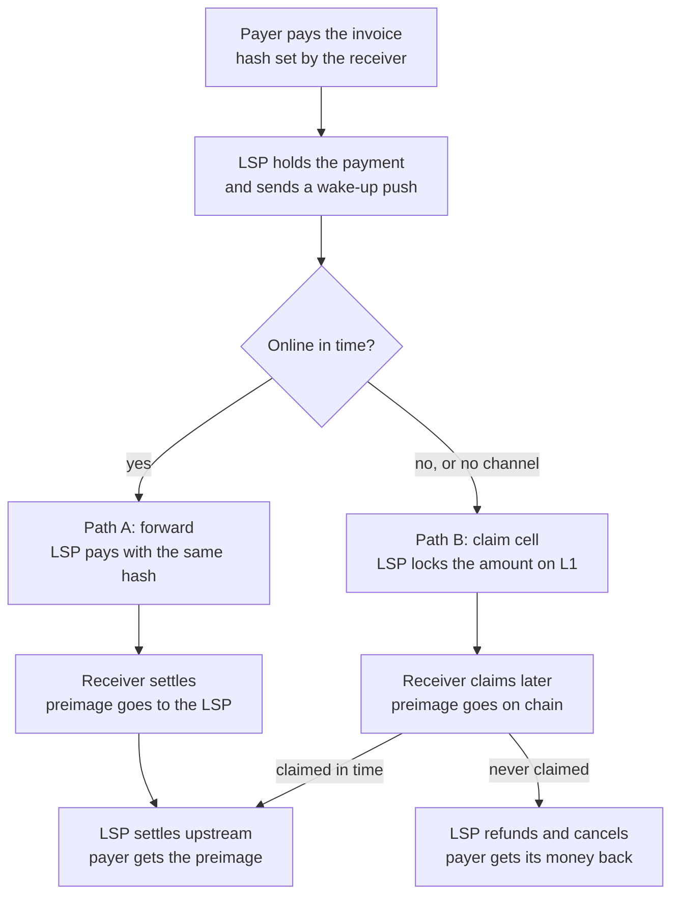

# [DIS] Async receive and on-chain claim for Fiber LSPs

Draft proposal for the CKB Community Fund DAO. Not yet submitted.

## Summary

This proposal adds one capability to the LSPs now being built for Fiber: paying a receiver who has no channel, not enough inbound capacity, or no CKB, without the LSP taking custody. It does this with an on-chain claim: the LSP locks the amount in an L1 cell that only the receiver can claim, and collects from the payer only after the receiver has been paid.

Public LSPs are already under way. Fiber's own hosted LSP support is in review, and Cellula's public mainnet LSP, built on it, passed a Community Fund DAO vote on 16 November 2026. Both deliver a payment only over a channel the receiver already has. This work adds the path for a receiver who has none, and is meant to plug into those LSPs, not to run another one.

The mechanism already works. A draft specification, the L1 lock script, and a reference implementation of the module an LSP runs are public, and the full flow has run on three real Fiber nodes and the CKB testnet.

Receivers are meant to need no new wallet. A web page asks the wallet they already have for one signed message and does the rest itself, so that only an LSP has to switch the module on. So far this has run in a browser test with a raw key. No real wallet has been connected yet, and recovery on a second device works only for wallets whose signatures are deterministic, which leaves out passkey wallets. Which wallets work is established in package C.

**The ask is not fixed in this draft.** The work is split into packages, each with a fixed price. An advance of 10% is paid on approval and counted against package A; everything else is paid as each package is accepted. All of them come to USD 35,500 over about four and a half months; the core alone is USD 26,500. The final figure is set once the scope is agreed with the Fiber team and with LSP operators, and is recomputed from the same table.

## Where this fits

To receive a payment on Fiber, a user must be reachable and must already have a channel with enough inbound liquidity. Two efforts address this, and the second is built on the first: Cellula runs Fiber's LSP branch plus its own fixes.

|  | Fiber hosted LSP | Cellula public LSP | This proposal |
| --- | --- | --- | --- |
| Who | Fiber core team: [design](https://github.com/nervosnetwork/fiber/issues/1625), [PR #1623](https://github.com/nervosnetwork/fiber/pull/1623) | LusoCryptoLabs: [DAO proposal](https://talk.nervos.org/t/11089), [scale test](https://talk.nervos.org/t/11068) | This repository |
| Status | Pull request open. The design calls itself an integrated prototype, not production ready | [Vote passed](https://talk.nervos.org/t/11089/19) on 16 November 2026. Running on testnet | Reference implementation working on testnet |
| Model | One public node hosts many wallets. Each wallet keeps a private channel with it and signs on its own device | The same model, operated as a public service | A lock script and a module that an LSP adds |
| Where the channel comes from | The wallet funds its side. Liquidity policy is listed as an open question | The LSP funds channels of 299 CKB for the first 1,000 wallets | Not addressed. Left to the LSP |
| Receiver offline, has a channel | The LSP keeps the payer's payment pending and delivers when the wallet wakes: 24 hours by default, 7 days at most, then it fails the payment back | Inherits this. Its tests state that the payee must be awake to sign | Overlaps. See below |
| Receiver has no channel | Not supported. Delivery requires a registered wallet with a private channel | Not described | Claim cell on L1 |
| Payment larger than the channel can receive | Not addressed | Not addressed. A 299 CKB channel cannot receive more than that | Claim cell on L1 |
| Payment delivered on L1 | No. Funds are credited only by a channel update | No | Yes, this is the mechanism |
| Stablecoins, receiver with no CKB | Not designed. The only asset rule is that amount and asset match | Stablecoins not named in the proposal | Script-level support verified on testnet. The LSP fronts the cell capacity |

This table is built from the documents linked in it, read on 17 November 2026. Either team may have plans that those documents do not show.

What the table shows:

- **The offline case is already handled.** Fiber's hosted delivery holds a payment for a sleeping wallet, which is what this project's path A does. Path A exists in the reference implementation and is not developed further here.
- **Three cases are not handled by anyone.** A receiver with no channel, a payment larger than the receiver's inbound capacity, and a stablecoin payment to a receiver with no CKB. In each, the hosted LSP has nothing to deliver over, and today the payment fails or needs a hub that holds the money, which is how Fiber Link works.
- **The claim cell is a natural fallback for hosted delivery.** Where the hosted LSP would fail a payment back because there is no channel, no capacity, or no time left in the buffer window, it can open a claim cell instead. That is the integration proposed in package D.

## What already exists

Everything below is public at [Akane-CN/fiber-claim-cell](https://github.com/Akane-CN/fiber-claim-cell) and can be reproduced from the repository.

| Item | Status |
| --- | --- |
| [RFC 0001](../rfcs/0001-async-receive.md): async receive | Draft. Timing rules checked against the Fiber source at commit `21c4dfb` |
| `async-claim-lock` L1 script | Implemented in Rust, 17 KB. 33 script-level tests pass in the CKB-VM verifier. The build is reproducible and checked against the deployed code hash |
| Lock script on testnet | [Deployed](https://testnet.explorer.nervos.org/transaction/0xb367c3c1a9b840df3c4ea5838ec2190a1a6a16f61da9961912c38d5dd520e186). 25 on-chain checks pass for CKB and xUDT, including 15 transactions the node had to reject and did |
| LSP-side module | Reference implementation: registration, hold invoices, per-payment state machine, exposure cap, HTTP interface, and a refund watcher that holds no key. CKB payments only. It is a module for an LSP to run, not an LSP |
| End-to-end run | 27 checks pass on three Fiber v0.10.1 nodes built from source, on CKB testnet |
| LSP node down when a claim lands and never back to settle it | Run once on testnet at real timings (about six hours), with two payments. The LSP node was down when the receiver claimed both. It came back for about a minute, settled one of them over the channel, and was then stopped for good with the other unsettled. A keyless relay had passed the preimage from L1 to a standalone Fiber watchtower, which [collected that payment on chain](https://testnet.explorer.nervos.org/transaction/0xf1795e601a7c34a7dca16735f8860a60f61ae3bf3a84b52b3fd21330b922c44f) after the payer's node force-closed. 9 of 10 checks pass. The recovery succeeded; the check that failed is the timing of the force close, which came at minute 266, one minute outside the expected window, after the test machine restarted and took the payer's node down for up to 20 minutes. When the run ended the payer's node still showed the payment as in flight, so the run does not show the payer's side reaching a final state |
| Internal review | One adversarial review each of the script and of the LSP-side and page code. Every finding and what was done about it is in [review-notes.md](review-notes.md). It is not a substitute for the audit in package E |

A receive web app is also working. It turns an existing wallet into a receiver without changing the wallet: the page derives the payment secrets from one signed message, checks each claim cell against the chain, and submits the claim, which needs no signature. In a browser test on testnet, a wallet with no CKB and no Fiber node [collected 248.75 CKB](https://testnet.explorer.nervos.org/transaction/0x4d2cb410b9db009db8dfdd8a71f4a79cd18e9f39c4969ea8fae850c9b173bd94) with no action beyond opening the page, and a second device with empty browser storage recovered the same pay link and history from the wallet alone. 11 checks pass. The test signs with a raw key; connecting a real wallet through the CCC connector is built in but has not been exercised. Recovery on another device relies on the wallet producing the same signature for the same message. Wallets that sign with passkeys do not, so for them the receiving identity lives only in the browser that created it.

The end-to-end run used an ordinary Fiber node as the payer, with no knowledge of this protocol:

| Scenario | Result on testnet |
| --- | --- |
| Receiver wakes up and is paid over its channel | Payer paid 100 CKB, receiver got 99.9 CKB, payer got the receiver's preimage. About 10 seconds end to end |
| Receiver offline, claims later on L1 | A wallet that had never held CKB [claimed 298.7 CKB](https://testnet.explorer.nervos.org/transaction/0x59b813b8fbfd3ae095504fa2302ba42a0a12aa40f37e3d858d2f4ab260760eb7) with no signature. The LSP read the preimage from the chain and the payer's payment then succeeded |
| Nobody claims | The LSP [refunded](https://testnet.explorer.nervos.org/transaction/0xbe002334bc2ed607859d95d48569d18781892a1a7ad9499e8e08221326904aa3) after expiry. The payer's payment failed cleanly and its channel balance returned to its original value |
| LSP crashes while sending a claim cell, restarts, then is down when the cell expires | The restarted LSP sent the [same transaction](https://testnet.explorer.nervos.org/transaction/0x245fca069c922d42b6023e6434b20a9c8ea8aae22dc9a8cab2ca83211b03bfbc) again and only one claim cell existed. While the LSP was down, a watcher holding no key [refunded](https://testnet.explorer.nervos.org/transaction/0x5ba6d757e187d16f718d266d13c64b265a8a171874e3400c85ac785df0cedc5c) the expired cell. The LSP came back, read the refund from the chain, and returned the payer's money |

Reading the Fiber source also turned up two places where the public RPC documentation disagrees with the code, and one rule it does not state. The minimum final expiry delta is 160 minutes, not the documented 16 hours. `cancel_invoice` works on a held payment, not only on an open invoice as documented. And a hold invoice has no hold timeout of its own, which the documentation does not say either way: the 120-second hold timeout in the code applies only to multi-part payments whose preimage is already known. The RFC is written against the code.

What this work has not yet shown:

- The refund and crash scenarios shortened the claim cell's expiry to 90 and 150 seconds. Only the watchtower run used real, hours-long timings, and it ran once. A refund at real timings has not been tested.
- xUDT was verified at the script level only, not end to end.
- In the watchtower path, an upstream peer that does not force-close and a preimage that reaches the watchtower late have not been run.
- No real wallet has been connected to the receive page.
- The receiver cannot yet check the amount it is paid against what the payer sent. See Risks.
- The lock script has not been audited.

## How it works

Both paths use one payment hash whose preimage only the receiver knows, so the LSP can collect from the payer only after the receiver has been paid.

**Async receive (RFC 0001, working today).** The receiver registers a pool of payment hashes with the LSP. The LSP issues hold invoices from that pool and holds an incoming payment without settling it.

- **Path A.** The receiver wakes up and hands the LSP an invoice for the same hash. The LSP pays it over their channel, learns the preimage when the receiver settles, and settles upstream.
- **Path B.** If the receiver does not show up, or has no channel, the LSP locks the amount in a claim cell on L1. The cell's lock checks no signature. It only constrains outputs: a claim with the preimage can pay only the receiver, and a refund, which becomes valid at expiry, can pay only the LSP. Expiry does not close the claim path: from then until one of the two confirms, both are valid and they race. The receiver's safety therefore also rests on client-side checks, described under Risks. The receiver claims later with a single L1 transaction and needs no CKB to do it, because the fee comes out of the cell.
- **Refund.** If nobody claims, the LSP refunds the cell and cancels the invoice, and the payer's payment fails with nothing lost.

Under HTLCs the payer's payment stays pending until the receiver reveals the preimage, for at most the invoice's final expiry delta, which Fiber caps at 14 days. This is a limit of the design, stated in the RFC.

**Receiving stablecoins with zero CKB.** A UDT cell needs 142 CKB of capacity that a new user does not have. On path B the LSP fronts that capacity and deducts its value from the payment at a quoted rate. The script-level version of this already passes on testnet.

## Scope

The scope is the on-chain claim capability, made safe enough for an LSP operator to switch on. Everything is released under the MIT licence.

In scope:

- The `async-claim-lock` script: reproducible build, audit, mainnet deployment.
- RFC 0001, revised for the timing and liveness rules found in testing.
- The LSP-side module that holds a payment, opens and refunds claim cells, and settles upstream, with the safeguards an operator needs: refund watchers, an exposure cap, crash recovery.
- A client library that carries the receiver's safety checks, so wallets do not reimplement them.
- Stablecoin payments end to end, including capacity fronting for receivers with no CKB.
- An integration with Fiber's hosted LSP model, so that the claim path takes over where a hosted delivery cannot complete.

Dropped from the earlier draft, because others are already building them:

- Holding a payment for an offline wallet that has a channel. Fiber's hosted delivery does this, with a 24-hour default window.
- A specification and implementation for giving wallets inbound channels. Fiber's LSP support and Cellula's LSP cover this.
- A public reference LSP on mainnet. Cellula's is funded and has its own liquidity.
- Liquidity capital of any kind.

## Work packages and budget

Each package has a fixed price and is paid when it is accepted, less any advance already counted against it (see Payment terms). If a package costs more to deliver than its price, the difference is not charged. The ask is the sum of the packages finally included, so the total is not fixed until the package list is.

| Package | What is delivered | Fixed price, USD | In the core |
| --- | --- | --- | --- |
| A. Hardening | RFC 0001 revised, including a rule that lets the receiver check the amount, implemented in the module. Tests at real timings, including the point where the node returns a held payment. Recovery from an LSP outage while claim cells are live. Refund watcher, preimage relay and exposure cap taken from the working prototypes to production. Signed receiver authentication, a real database | 6,500 | Yes |
| B. Stablecoins | xUDT payments end to end on testnet, with capacity fronting and its pricing | 4,500 | No |
| C. Client library | TypeScript library on CCC: hash pool, claim cell verification, confirmation and expiry rules, on-chain claim. The receive web app, which works with existing wallets through one signed message, taken from working prototype to release and tested with real wallets | 6,000 | Yes |
| D. LSP integration | The claim path as the fallback inside Fiber's hosted LSP: when a delivery would fail for lack of a channel, capacity or time, a claim cell is opened instead. Built on Fiber's LSP support once it is released | 4,500 | No |
| E. Audit and mainnet | Third-party audit of the lock script, of the client library's claim logic, and of how the web app derives and stores its secrets. Fixes. Mainnet deployment with the code hash published | 11,500 | Yes |
| F. Running costs | Test infrastructure, mainnet deployment capacity, buffer for audit rework. A ceiling, not a fixed price: paid at actual cost | 2,500 | Yes |
| **All packages** |  | **35,500** |  |
| **Core only** | A, C, E, F | **26,500** |  |

Two things can still change the total:

- **Audit fee.** USD 10,000 of package E's price is the auditor's fee. It is an estimate until a firm quotes for the script and the client logic together, and the price of E moves with the quote. Any saving is returned.
- **Packages B and D.** B depends on which stablecoin LSP operators want first. D depends on an operator agreeing to integrate and on Fiber's LSP support being released; without both it is left out and not charged.

All packages together take about four and a half months.

For scale, among Community Fund DAO proposals: Cellula's public LSP was approved at USD 22,258 plus up to USD 1,664 contingency. [Pocket Node](https://talk.nervos.org/t/dis-mobile-ready-ckb-light-client-pocket-node-for-android/9879) asked for USD 15,000 for one developer over four months.

Three months of maintenance after the last package are included at no extra cost.

## Payment terms

Payment follows the Community Fund DAO rules as they stand. This proposal adds no terms of its own.

- **Amount.** The rules have budgets requested in CKB. The prices in this document are in USD. The voting post states the request as a CKB amount, converted from the final USD total at the CKB price on the day it is posted, and shows both figures.
- **Quorum.** Three times that CKB amount, as the rules require.
- **Stages.** The budget is over USD 10,000, so it is paid in stages. 10% of the final total is paid on approval, inside the rule's limit of 20% and USD 10,000. That advance is not extra money: it is counted against package A, and the rest of A's price is paid when A is accepted. Every other package is paid in full when it is accepted. Package F is settled last, at actual cost up to its ceiling, and what is not spent is not claimed.
- **Final amount.** The request is fixed before the voting post, from the packages finally included and the auditor's quote, and does not change after the vote.
- **Reporting.** At each stage, a public report of what was delivered and what was spent, as the rules require.
- **Disbursement.** By the DAO's funds management committee under its default rules.

## Risks

| Risk | How it is handled |
| --- | --- |
| Fiber's LSP support or Cellula's LSP ends up covering the same cases | The comparison under "Where this fits" is drawn from both teams' public documents and is sent to them before posting. Drop any package they already cover. The on-chain claim is built as a module they can adopt, not a competing service |
| Claim and refund race after expiry. The script lets a claim through after expiry until the refund confirms, so a receiver who reveals the preimage too late can lose it to a refund that lands first | The receiver's client must stop claiming a fixed margin before expiry, and must wait for confirmations on the claim cell before revealing anything. These checks live in the client library, wallets use the library instead of reimplementing them, and the library's claim logic is inside the audit scope alongside the script |
| The LSP is offline when a claim lands. The node returns the incoming payment about 161 minutes before that payment expires. An LSP that is down between a claim and that point pays the receiver and collects nothing. A payer and a receiver acting together, or one person playing both, can time a claim to an outage and take the full amount | Four layers. (1) The gap is sized to the operator's recovery time: at least 24 hours, not the 4 hours used in testing, which leaves about 21 hours to come back and settle. (2) The refund needs no signature, so independent watchers submit it the moment the cell expires. (3) A watcher separate from the node reads the preimage from L1 and hands it to Fiber's watchtower, so the payment can still be collected on chain after a force close. Fiber's source shows this works only if the upstream peer force-closes, the preimage reaches the watchtower in time, and the LSP runs the watchtower itself. This was run once on testnet with real nodes and real timings. The LSP node was down when the claim landed, came back for about a minute to settle a second payment, and was then stopped for good with this one unsettled. The payer's node [force-closed](https://testnet.explorer.nervos.org/transaction/0x35c539ced670c704193d5e07140a34b0813069e0a2b010b78360cf8e812ed5a4) at minute 266, and the watchtower [collected the 200 CKB](https://testnet.explorer.nervos.org/transaction/0xf1795e601a7c34a7dca16735f8860a60f61ae3bf3a84b52b3fd21330b922c44f) 82 minutes later, 62 minutes before the payment expired. 9 of 10 checks pass: the one that failed is the timing of the force close, and the payer's node still showed the payment as in flight when the run ended. One run on one channel is not enough. The cases where the upstream peer does not force-close or the preimage arrives late, and the payer's final state, are tested in package A. (4) The value in live claim cells is capped per receiver and overall, which bounds the worst case |
| The receive page does not work with a given wallet. It has been tested only with a raw key, and recovery on a second device needs deterministic signatures, which passkey wallets do not give | Compatibility is not promised in general. Package C is accepted only when two different existing wallets have each collected a payment unchanged, and the release lists the wallets tested and those that cannot recover on a second device |
| The receiver cannot check the amount. The page learns what the payer paid from the LSP, so an LSP could open a smaller claim cell, let the receiver claim it, and settle the full amount upstream | Open in the RFC today. The revision in package A has to close it, for example by having the receiver fix the amount for each hash or the payer carry it to the receiver, and the client library then enforces the rule |
| The audit finds a serious flaw | No mainnet deployment until every high finding is fixed. The script is under 500 lines with no signature verification. Package F holds a buffer for rework |
| Held payments tie up liquidity along the route | Invoices cap how long a payment may be held. Multi-part payments are disabled because Fiber can settle them partially when held. Designs based on PTLCs that remove the hold are out of scope |
| Fiber's RPC and LSP interfaces are still changing | Fiber calls sit behind one client module, each release pins a Fiber version, and package D starts only after Fiber's LSP support is released |
| An operator enabling this needs capital locked in claim cells | The exposure cap sets how much. This proposal asks for no capital; an operator funds its own |
| No LSP operator adopts it | Adoption is reported at each milestone but is not an acceptance criterion, because it is not ours to deliver. Package D is charged only if an operator commits |
| CKB price moves | The request is made in CKB, as the DAO rules require, converted from the USD total on the day of the voting post |

## Acceptance and targets

Acceptance criteria are things the team can deliver on its own, and each can be checked by anyone. Results that depend on other people are listed separately as targets: they are reported, but a milestone does not wait on them.

| Package | Accepted when |
| --- | --- |
| A. Hardening | The revised RFC 0001 is published and open for review, with a rule for how the receiver checks the amount. A public test report shows the flow at real timings, the behaviour at the point where the node returns a held payment, and recovery from an LSP outage with claim cells live. Watchtower settlement has worked once; the report covers what that run did not: an upstream peer that does not force-close, a preimage that arrives late, a refund at real timings, and the payer's final state |
| B. Stablecoins | A wallet holding no CKB receives a stablecoin payment through a claim cell on testnet, and the transactions are public |
| C. Client library | The library is on npm. Its tests show it refusing each unsafe claim: wrong cell, too few confirmations, too close to expiry. The receive web app collects a payment on testnet with at least two different existing wallets, with no change to either wallet. The release lists the wallets tested and those that cannot recover on a second device |
| D. LSP integration | The module runs inside the partner's LSP on testnet, and a payment to a receiver with no channel completes through it |
| E. Audit and mainnet | The audit report, covering the script, the client claim logic and the web app's secret handling, is public. Every high and medium finding is fixed. The script is on mainnet and its code hash matches the audited build. One payment to a wallet with no CKB and no channel completes on mainnet through our own instance, with the exposure capped |
| F. Running costs | Not a deliverable. Settled against receipts published with the final report, up to the ceiling. Unspent money is not claimed |

Targets, not criteria:

- At least one LSP operator, other than our own instance, switches the claim path on on mainnet. The intent is that no wallet has to change for this; which wallets that holds for is reported from package C.
- At least one Fiber core developer reviews RFC 0001. What we commit to is submitting it in a reviewable form and answering every comment in public.
- A second party runs the module from the documentation without our help.

## DAO process and what is left to confirm

The rules below are the ones in force, as far as could be verified. The DAO v1.1 platform is not: its 16 March 2026 launch was [postponed by the steward team](https://talk.nervos.org/t/10096), and Cellula's vote in November 2026 ran on Metaforo under the existing rules.

| Step | Rule |
| --- | --- |
| Discussion | A `[DIS]` post on Nervos Talk for about a week. It moves on with 30 likes |
| Vote | A `[VOT]` poll on [Metaforo](https://dao.ckb.community/), open 7 days, weighted by Nervos DAO deposits |
| To pass | At least 51% yes, and total votes of at least three times the CKB requested |
| Who can start the vote | An account with at least 100,000 CKB deposited in the Nervos DAO |
| Voting post | The receiving CKB address on the first line, which cannot be edited later, and a link to the discussion post |
| Payment | Budgets over USD 10,000 are paid in stages: at most 20% and at most USD 10,000 up front, the rest against milestones with a report at each stage |

Source: [CKB Community Fund DAO Rules and Process](https://talk.nervos.org/t/ckb-community-fund-dao-rules-and-process/6874), with its 2023 amendments. The rules have budgets requested in CKB and say nothing about USD conversion, so the voting post states a CKB amount.

Still to confirm before posting:

- [ ] Check with the DAO stewards which platform and rules apply on the day of posting, in case v1.1 has gone live by then.
- [ ] Send the comparison under "Where this fits" to the Fiber team and to LusoCryptoLabs. It is built from their public documents, and they may have plans those do not show.
- [ ] Ask both whether they would adopt the claim path, and decide packages B and D from the answers.
- [ ] Fix the total from the final package list and the audit quote.
- [ ] Convert the final USD total to CKB at the price on the day of the voting post, and state both figures in it.

A smaller first step is also open. With a working implementation already public, package A alone could go to the Spark Program, which is the path Fiber Link took before coming to the DAO.

## Sources

- [Akane-CN/fiber-claim-cell](https://github.com/Akane-CN/fiber-claim-cell): RFC 0001, the lock script, the LSP-side module, and the testnet reports.
- [Fiber PR #1623, LSP support](https://github.com/nervosnetwork/fiber/pull/1623): the core team's LSP work, open at the time of writing.
- [[DIS] Cellula on Fiber](https://talk.nervos.org/t/11089) and its [vote result](https://talk.nervos.org/t/11089/19): the funded public LSP, its budget and its payment terms.
- [Statement on DAO V1.1 Platform Launch](https://talk.nervos.org/t/10096): the postponement of v1.1.
- [CKB Community Fund DAO Rules and Process](https://talk.nervos.org/t/ckb-community-fund-dao-rules-and-process/6874): the rules in force.
- [Fiber: Protocol-Complete, Network-Tested – 2026 Outlook](https://talk.nervos.org/t/fiber-protocol-complete-network-tested-development-status-challenges-and-2026-outlook/9827): liquidity as a 2026 focus.
- [[DIS] Fiber Link](https://talk.nervos.org/t/dis-fiber-link-a-ckb-fiber-based-pay-layer-tipping-micropayments-for-communities/9845): the custodial hub design.
- [Fiber source at commit 21c4dfb](https://github.com/nervosnetwork/fiber/tree/21c4dfbdbd48ca3eac55332c9f1cc3e241b1582e): hold invoice behaviour and expiry constants.
- [async-claim-lock, refund and payout checks](../contracts/async-claim-lock/src/main.rs): the script rules described under Risks.
- [Fiber issue #1625, multi-tenant hosted LSP design](https://github.com/nervosnetwork/fiber/issues/1625): the hosted model, delivery buffering, trust assumptions and non-goals.
- [Cellula LSP scale test](https://talk.nervos.org/t/11068): architecture and the requirement that the payee be awake to sign.
