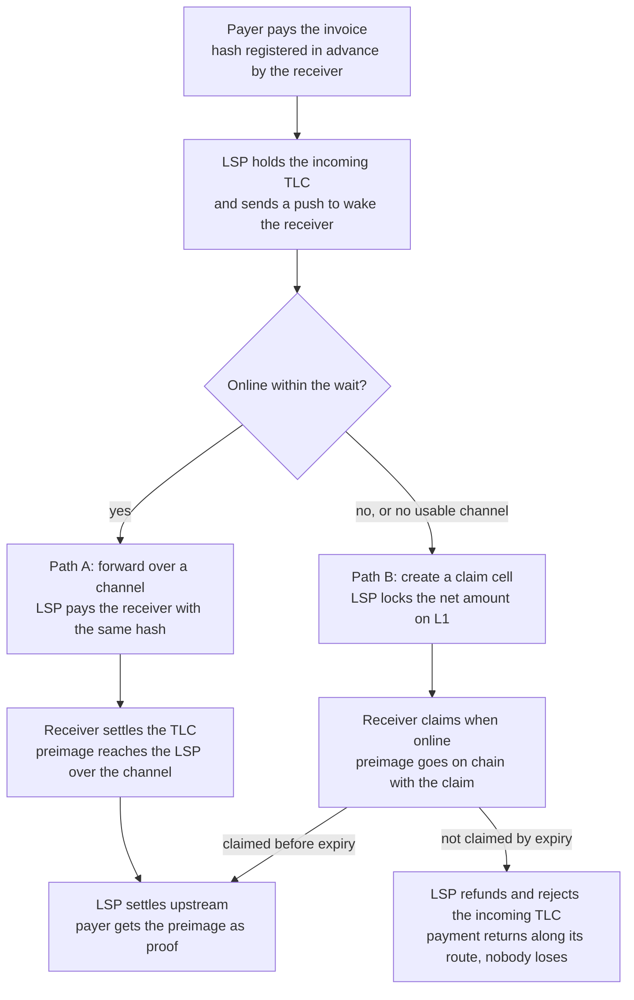

# RFC: Async receive on Fiber (hold and wake, with an on-chain claim fallback)

| Field | Value |
| --- | --- |
| Number | To be assigned |
| Category | Standards Track |
| Status | Draft |
| Author | To be filled in |
| Created | 2026-11-14 |

## Abstract

This RFC defines a protocol that lets a receiver who is often offline receive payments on Fiber without custody. The LSP uses a hold invoice to hold the incoming TLC and wakes the receiver. If the receiver comes online in time, the payment is forwarded over a channel (path A). Otherwise the LSP locks a claim cell on L1 that can only pay the receiver, and the receiver claims it on chain later with the preimage (path B).

Both paths use the same payment hash, and only the receiver knows the preimage. The protocol guarantees:

- **The LSP cannot take the money.** The LSP can settle upstream only after the receiver has been paid and the preimage has become public as a result.
- **The payer neither overpays nor pays for nothing.** The payment either completes, with the preimage as proof, or is returned along its route after expiry.
- **The receiver can be paid without a channel.** Path B needs only one L1 transaction, and a new user with no CKB can claim.

What the protocol does not guarantee: under HTLCs, the payment stays "in progress" on the payer's side until the receiver comes online and reveals the preimage. The longest wait is bounded by the upper limit of a Fiber invoice's `final_expiry_delta` (14 days), and liquidity along the route is tied up for that time. Removing this requires PTLCs and static invoices, which are out of scope for this RFC.

## Motivation

A Fiber receiver must be online to be paid, and mobile and browser wallets are offline most of the time. There are two existing approaches, each with a flaw:

- **Custodial receiving**: a hub receives on the user's behalf and the user withdraws when online. The experience is good, but the user must trust the hub not to misuse the funds.
- **Hold and wake only**: non-custodial, but the receiver must already have a channel with enough inbound capacity, and must be online at the same time as the LSP to complete a channel update.

This RFC makes the second approach the preferred path and adds an on-chain fallback path. The fallback solves three problems:

1. A receiver with no channel, or without enough inbound capacity, can still be paid, without opening a channel first.
2. The claim is a one-way L1 transaction. It does not require the receiver and the LSP to be online at the same time, and an LSP outage does not prevent the claim.
3. Once the funds are on chain, the LSP's money is locked and the receiver can verify it independently.

This path is practical on CKB because L1 fees are low, blocks are fast, and a lock script can constrain where a transaction's outputs go.

### Relation to Fiber's hosted LSP

The hosted LSP that the Fiber team has under review ([design note](https://github.com/nervosnetwork/fiber/issues/1625), [PR 1623](https://github.com/nervosnetwork/fiber/pull/1623)) already covers the case "receiver offline but already has a channel": the LSP keeps the upstream payment pending and delivers it over the channel when the wallet wakes, with a default window of 24 hours and a maximum of 7 days. This does the same job as path A of this RFC. Under the hosted model it should be used directly, and path A is meaningful only for wallets that run their own node.

Hosted delivery requires the receiver to already have a channel, and funds are credited only through a channel state update; there is no L1 delivery path. It cannot deliver in the following three cases, which are the ones path B fills:

- The receiver has no channel yet.
- The payment amount exceeds the inbound capacity of the receiver's channel.
- The payment is in a stablecoin and the receiver has no CKB.

Path B therefore fits as the fallback for hosted delivery: when a delivery is about to fail because there is no channel, not enough capacity, or the buffer window is running out, a claim cell is created instead.

## Roles and terms

"MUST", "MUST NOT", "SHOULD" and "MAY" in this document are to be read as in RFC 2119.

| Term | Meaning |
| --- | --- |
| Payer | The Fiber node that pays the invoice. It needs no knowledge of this protocol |
| LSP | A Fiber node that is always online. It issues invoices, holds TLCs, and forwards or creates claim cells |
| Receiver | A user who is often offline and holds the preimage. It may run a Fiber node, or have only an L1 address |
| Preimage `r`, payment hash `H` | `H = hash(r)`, with the same hash algorithm as the Fiber invoice (`ckb_hash` or `sha256`) |
| Hash pool | A batch of payment hashes the receiver registers with the LSP in advance. Each is used once |
| Incoming TLC | The TLC by which the payment reaches the LSP, with amount `A` and expiry `E_in` |
| Path A | The LSP pays the net amount to the receiver over a channel, using the same `H` |
| Path B | The LSP creates a claim cell on L1, and the receiver claims it on chain with `r` |
| Claim cell | A cell locked with the lock defined in this RFC. It can only be paid to the receiver with `r`, or returned to the LSP after expiry |
| Net amount | `A` minus the LSP's fee: the amount actually paid to the receiver |

## Protocol overview



Both paths end the same way: the LSP obtains the preimage and settles upstream. The payment is returned only when path B expires with no claim.

## Specification 1: registration, hash pool and invoice issuance

Invoices are issued by the LSP, but the payment hash comes from the receiver, so the LSP never knows the preimage.

1. **Generate the hash pool**: the receiver generates a batch of random preimages `r_i` and computes `H_i = hash(r_i)`. Preimages are stored only locally. Preimages MUST be generated from a cryptographically secure random source and MUST NOT be derived from data the LSP can derive.
2. **Register**: the receiver registers the following with the LSP, signed with its own key:
   - The hash pool `H_1 … H_n` and the hash algorithm used.
   - The receiver's L1 lock script, used for path B.
   - The receiver's Fiber node public key (optional; without it only path B is available).
   - A wake-up endpoint: an opaque push token.
3. **Issue invoices**: when someone asks to pay this receiver, the LSP takes an unused `H` from the hash pool and calls Fiber's `new_invoice` with `payment_hash` only and no preimage, that is, a hold invoice, with `allow_mpp` turned off. The invoice's `final_expiry_delta` MUST satisfy the lower bound in "Specification 4".
4. **Single use**: each `H` can be used for one invoice only. After the invoice expires or is cancelled, that `H` is void and MUST NOT be put back in the pool.
5. **Replenish**: when the hash pool falls below a threshold, the LSP SHOULD prompt the receiver to replenish it in the wake-up notification. When the pool is empty the LSP MUST refuse to issue new invoices.

The receiving node the payer sees is the LSP. This is transparent to the payer and also hides the receiver's node identity.

### Deriving preimages from a wallet signature

Instead of generating preimages at random, the receiver MAY derive them from one wallet signature. The receiver then needs only an existing wallet that can "connect" and "sign a message"; the wallet itself needs no change for this protocol, and the preimages need no separate backup.

1. **Seed**: the wallet signs a fixed message. The message states its purpose and the hash of the receiving lock, so a signature made for another purpose or another address does not give the same seed. `seed = SHA-256("fiber-claim-cell/seed/v1:" ‖ signature)`.
2. **Preimages**: the `i`-th preimage at a given LSP is `HMAC-SHA256(seed, "preimage/" ‖ LSP node public key ‖ "/" ‖ i)`, registered in index order. The hashes differ for each LSP: otherwise a preimage made public by a claim at one LSP could be used by another LSP to settle a payment with the same hash there, without paying the receiver.
3. **Authentication**: the receiver's access token is `HMAC-SHA256(seed, "auth/" ‖ LSP node public key)`, and only its SHA-256 is given to the LSP at registration. The token is likewise specific to each LSP: a token given to one LSP is invalid at another. The receiver ID is computed from the lock hash and this value, so the same wallet registering again on another device returns to the same record.

The LSP sees only hashes and cannot derive any preimage without the seed. Points to note:

- Whoever obtains this signature can reveal preimages on the receiver's behalf. The money can still only be paid to the receiver's on-chain address, or to the Fiber node the receiver registered (see path A), but the receiver loses control over when a claim happens. The receive page MUST therefore warn the user to sign this message only on a trusted page. The message itself is not bound to a website origin, and any website can request the same signature; this is defended by the warning, not by cryptography.
- The receive page MUST NOT read the LSP address or the CKB node address from link parameters. Otherwise a link pointing at the legitimate page could make the page take the user's seed to someone else's server.
- The receive page MUST use its own built-in lock script code hash and not the value the LSP reports. For the confirmation count `N_conf` and the margin `Δ_margin`, the values the LSP reports can only raise, never lower, the page's built-in floors.
- After broadcasting a claim transaction, the page MUST track it until it confirms. If it disappears from the transaction pool while the claim cell still exists, the page MUST send it again. The preimage is public once broadcast, and letting the claim lapse after that amounts to handing the money to the LSP.
- A wallet with deterministic signatures (for example a secp256k1 wallet that signs per RFC 6979) recovers by signing again on a new device. A wallet with non-deterministic signatures (for example a passkey-based wallet) gets a different seed from each signature. In that case the seed exists only in the current browser, and a new device gets a new receiving identity. Funds not yet claimed under the old identity are returned to the payer after expiry: they are not lost, but they are not received either.
- The seed is kept in the browser's local storage and leaks if a script is injected into the page. This part needs to be within the audit scope.

## Specification 2: path A, hold and wake

Path A chains two payments with the same payment hash, so the receiver is paid at the moment it reveals the preimage.

1. **Hold**: the incoming TLC arrives and the invoice status becomes `Received`. The LSP records the amount `A` and the expiry `E_in`, and neither settles nor rejects.
2. **Wake**: the LSP sends a notification to the receiver's wake-up endpoint. The notification MUST NOT contain the amount, the hash, or information about the payer. The receiver fetches the details through the authenticated interface after coming online.
3. **Request delivery**: after coming online, the receiver creates an ordinary Fiber invoice with the corresponding preimage, with the same payment hash `H` and the net amount, and submits it to the LSP.
4. **Check**: the LSP MUST check that:
   - The invoice's payment hash equals `H` and the hash algorithm matches.
   - The invoice amount does not exceed `A` minus the path A fee.
   - The timing still satisfies the path A condition in "Specification 4".
   - No claim cell has been created for this `H`.
5. **Forward**: the LSP pays this invoice over its channel with the receiver.
6. **Settle**: the receiver's node settles the TLC, and the preimage `r` reaches the LSP over the channel. The LSP calls `settle_invoice(H, r)` to settle upstream, and the payer obtains `r`.

When the receiver has no channel, not enough inbound capacity, or does not come online within the wait `T_wake`, the LSP moves to path B.

## Specification 3: path B, the claim cell

The claim cell's lock verifies no signature. It only constrains where the money goes: with the preimage it can only be paid to the receiver, and after expiry it can only be returned to the LSP. Anyone can therefore submit the transaction on the receiver's behalf, and the receiver does not need to hold CKB to pay the fee.

### Cell structure

| Field | Content |
| --- | --- |
| capacity | `C_total` = `receiver_capacity` + change |
| lock | `code_hash` is this RFC's async-claim-lock; `args` as in the table below |
| type | Empty (paying CKB), or the xUDT type script (paying a stablecoin or other UDT) |
| data | Empty, or the UDT amount (16 bytes, little-endian) |

### lock args (89 bytes in total)

| Field | Bytes | Meaning |
| --- | --- | --- |
| `flags` | 1 | Bit 0 is the hash algorithm: 0 is `ckb_hash`, 1 is `sha256`. All other bits MUST be 0 |
| `payment_hash` | 32 | The payment hash `H` |
| `receiver_lock_hash` | 20 | The first 20 bytes of the receiver's lock script hash |
| `refund_lock_hash` | 20 | The first 20 bytes of the LSP's refund lock script hash |
| `expiry` | 8 | The time `T_claim` at which the refund becomes valid, encoded in the absolute-timestamp form of `since` |
| `receiver_capacity` | 8 | The CKB capacity that must be paid to the receiver, in shannons |

### Unlock rules

Both rules share one precondition: the claim cell MUST be the transaction's only input.

The script checks only outputs, and an output counts as this cell's payment only if no other script in the transaction is also counting on it. What can count on the same output is not only another claim cell, but also another version of this script (a different code hash, so neither sees the other), and cells owned by the receiver or by the LSP whose lock is of the "anyone can pay" kind: such a lock requires only "some output pays me no less than before", so one output can satisfy both it and this script, and the surplus is taken by whoever builds the transaction. With only one input allowed, none of these cases can arise. An earlier version forbade only a second input with the same code, which did not stop the latter two; it is obsolete.

The cost is that a third party cannot add inputs to pay the fee, and refunds cannot be merged. The fee can only come out of the cell itself, up to `FEE_CAP`.

**Claim** (the witness's lock field is the 32-byte preimage):

1. `hash(preimage)`, computed with the algorithm given by `flags`, MUST equal `payment_hash`.
2. The first 20 bytes of output 0's lock script hash MUST equal `receiver_lock_hash`, and its capacity MUST be at least `receiver_capacity`.
3. If the claim cell has a type script, output 0 MUST have the same type script, its UDT amount MUST be at least the claim cell's amount, and its data MUST be exactly 16 bytes.
4. If the claim cell has no type script, output 0 MUST NOT have a type script and its data MUST be empty. Otherwise a third party who submits the transaction first could attach content to the receiver's cell that makes it hard to spend.
5. Let the change be `C_total − receiver_capacity`. When the change is greater than the fee cap `FEE_CAP`, output 1's lock hash MUST match `refund_lock_hash` and its capacity MUST be at least the change minus `FEE_CAP`; output 1 MUST NOT have a type script and its data MUST be empty. The change is always plain CKB, for the same reason as in rule 4, except that here the victim would be the LSP.

**Refund** (the witness's lock field is empty):

1. The input's `since` MUST be in absolute-timestamp form and MUST NOT be less than `expiry`.
2. Output 0's lock hash MUST match `refund_lock_hash` and its capacity MUST be at least `C_total − FEE_CAP`. The requirements on the type script and data are the same as rules 3 and 4 of the claim path.

`FEE_CAP` is a constant in the script, set to 0.01 CKB. The transaction may have more outputs, and the script does not check anything beyond outputs 0 and 1, so whoever submits the transaction can keep at most the difference within `FEE_CAP` for themselves.

The witness is parsed as `WitnessArgs`: a missing lock field or one of length 0 takes the refund path, length 32 takes the claim path, and every other length is rejected. The script reads only the first 52 bytes of the witness and does not check the total length or the two later fields, so a valid claim transaction can carry a witness that a strict molecule parser would reject. When reading the preimage from the chain, the LSP MUST take it byte by byte the way the script reads it, and MUST NOT use a strict parser: when the two disagree, the receiver has already been paid, yet the LSP cannot recognise the preimage and so cannot settle upstream. The script is referenced with hash type `data2`, and the code hash is the data hash of the binary.

### Capacity and fronting

The claim cell's own occupied capacity is 130 CKB (paying CKB) or 211 CKB (paying xUDT). The LSP fronts it temporarily and gets it back at claim or refund.

| Case | `receiver_capacity` | Change |
| --- | --- | --- |
| Paying CKB | Equal to the net amount. MUST be at least the occupied capacity of the receiver's output (61 CKB for the standard secp256k1 lock) | The difference needed to bring `C_total` to 130 CKB. When not zero it MUST be at least 61 CKB, so that it can form the cell returned to the LSP |
| Paying xUDT | The occupied capacity of the receiver's UDT output (142 CKB for the standard lock), fronted by the LSP and owned by the receiver | 211 − 142 = 69 CKB, returned to the LSP |

When paying xUDT, the 142 CKB the LSP fronts is not recovered; it is deducted from the UDT amount at the rate quoted at registration. This lets a new user holding no CKB at all receive stablecoins.

In both cases the LSP SHOULD leave an extra fee reserve of no more than `FEE_CAP` in `C_total`. The claim transaction then needs no additional input, and the receiver can complete the claim with the claim cell alone.

### The LSP's obligations

- Once the transaction creating the claim cell is signed, the LSP MUST NOT take path A for the same `H`, or it would pay twice. The signed transaction MUST be written to disk before it is broadcast, and the same transaction is sent again after a restart. Only when one of its inputs has been spent on chain by another transaction, so that it can never confirm, may the LSP abandon it and build another.
- Before paying out anything (creating a claim cell or forwarding over a channel), the LSP MUST confirm that the incoming invoice is still `Received`.
- The outgoing invoice on path A MUST satisfy all of the following: the payee node is the node the receiver registered, the hash algorithm matches the incoming invoice, it is not a UDT invoice, and the amount does not exceed the net amount. The routing fee limit is set to the difference between the incoming and outgoing amounts. After the payment over the channel succeeds, the LSP MUST first verify that the preimage it obtained does correspond to `H` before settling upstream.
- The LSP MUST watch for the claim cell being spent, extract `r` from the claim transaction's witness, and call `settle_invoice` at once.
- When the cell expires unclaimed, the LSP submits the refund transaction. It calls `cancel_invoice` to return the incoming TLC upstream only after the refund has enough confirmations, so that a reorg cannot swap the refund for a claim. What happened to the claim cell is always decided by the chain: even after sending a refund itself, the LSP checks who actually spent the cell.

## Specification 4: timing parameters

The protocol's safety depends on the order of several expiry times: the money the LSP pays out must expire before the money it takes in.

| Symbol | Meaning | Value |
| --- | --- | --- |
| `t0` | The time the incoming TLC reaches the LSP | Measured |
| `E_in` | The expiry time of the incoming TLC | The TLC's actual expiry, read from the node's `list_channels`. The payer usually also adds `D_rand`, so the actual value is generally later than `t0 + D_final` |
| `D_final` | The invoice's `final_expiry_delta` | Fiber allows 160 minutes to 14 days. This protocol requires at least 24 hours and recommends 72 hours |
| `D_min` | Fiber's minimum requirement for the last hop's expiry delta (`MIN_TLC_EXPIRY_DELTA`) | 160 minutes |
| `D_rand` | The random offset `send_payment` adds to the outgoing TLC's expiry | A whole multiple of 4 hours, at least 4 hours |
| `D_fwd` | The LSP's expiry delta as a forwarding node | The channel's `tlc_expiry_delta`, 4 hours by default |
| `D_cut` | How long before a TLC's expiry the node returns it on its own | `commitment_delay_epoch` × 4 hours × 2/3, plus 60 seconds; about 161 minutes by default |
| `T_wake` | How long to wait for the receiver to come online for path A | LSP policy; 120 seconds recommended |
| `T_rec` | The longest time for the LSP node to go from an outage to recovery and completed settlement | Committed to by the operator; 20 hours recommended for a single-node operation |
| `Δ_settle` | The margin between the claim cell's expiry and the incoming TLC's expiry | At least `D_cut` + `T_rec` + 1 hour; 24 hours recommended |
| `T_claim` | The time the claim cell's refund becomes valid | `E_in − Δ_settle` |
| `Δ_margin` | The latest lead time at which the receiver may broadcast a claim transaction | 1 hour recommended |
| `N_conf` | The number of confirmations the receiver requires on the claim cell before claiming | 24 blocks recommended, to be determined |
| `W_min` | The minimum length of the claim window | 6 hours recommended |

Conditions that MUST hold:

```
Path A available:    now + D_min + D_rand + D_fwd ≤ E_in
Claim cell expiry:   T_claim = E_in − Δ_settle, and Δ_settle ≥ D_cut + T_rec + 1 hour
Path B available:    now + W_min + Δ_margin ≤ T_claim
Receiver claims:     the claim cell has N_conf confirmations, and now ≤ T_claim − Δ_margin
```

- `D_cut` is a hard constraint. When the incoming TLC is less than `D_cut` from expiry, the Fiber node returns it upstream on its own with `ExpiryTooSoon`, and after that it cannot be settled even with the preimage. The claim cell must therefore expire before this point, leaving the LSP time to notice the claim transaction and call `settle_invoice`.
- `settle_invoice` still returns success when the TLC has already been returned. The LSP MUST NOT treat a successful return as payment received and MUST wait for the invoice status to become `Paid`.
- `T_rec` determines how long an outage the LSP can withstand; see "The LSP's liveness requirement" under "Security analysis". Squeezing `Δ_settle` down to only 1 hour more than `D_cut` amounts to requiring that the LSP never be down for more than 1 hour.
- With the recommended values `D_final` = 72 hours and `Δ_settle` = 24 hours, path A is available for about 61 hours and the path B claim window is about 47 hours. At the 14-day maximum, the claim window is about 13 days.
- When neither path satisfies its timing condition any longer, the LSP MUST call `cancel_invoice` to reject the incoming TLC and let the payment return.
- A CKB script can only restrict "spendable after a certain time", not "before a certain time". After expiry, claim and refund are therefore both valid as far as the script is concerned, and "MUST NOT claim later than `T_claim − Δ_margin`" is a rule the receiver's client has to follow itself.
- The `since` timestamp is evaluated against the block median time, which lags real time by several minutes. A refund can therefore get on chain only a few minutes after `T_claim`, and the extra 1 hour in `Δ_settle` covers this.

## Specification 5: LSP interface and state machine

The interface is JSON-RPC 2.0 over HTTPS. Calls marked "receiver" MUST be signed with the key the receiver used at registration; the other two need no authentication.

| Method | Caller | Purpose |
| --- | --- | --- |
| `lsp_async_get_info` | Anyone | Returns the fee rates, timing parameters, supported assets, the code hash of async-claim-lock, the LSP's refund lock, minimum amounts, and the capacity-fronting rate |
| `lsp_async_register` | Receiver | Registers the L1 lock script, the Fiber node public key (optional), the wake-up endpoint and the first batch of hashes; returns the receiver ID |
| `lsp_async_add_hashes` | Receiver | Replenishes the hash pool |
| `lsp_async_request_invoice` | Payer or receive page | Takes the receiver ID, amount, asset and memo; returns a Fiber invoice |
| `lsp_async_list_pending` | Receiver | Lists pending payments: hash, amount, status, `E_in`; if a claim cell has been created, also its out point and `T_claim` |
| `lsp_async_receive` | Receiver | Submits an invoice with the same hash, requesting path A |

The states of each payment hash on the LSP side:

| State | Meaning | May move to |
| --- | --- | --- |
| `OPEN` | Invoice issued, no payment received | `HELD`, `FAILED` |
| `HELD` | Incoming TLC held, wake-up sent | `FORWARDING`, `CELL_PENDING`, `FAILED` |
| `FORWARDING` | The path A payment has been sent | `SETTLED`, `HELD` |
| `CELL_PENDING` | The transaction creating the claim cell has been broadcast | `CELL_LIVE` |
| `CELL_LIVE` | The claim cell is on chain | `CLAIMED`, `REFUNDING` |
| `CLAIMED` | The claim transaction is on chain and the LSP has the preimage | `SETTLED` |
| `REFUNDING` | Expired; the refund transaction has been broadcast | `FAILED`, `CLAIMED` |
| `SETTLED` | Upstream settled; final |  |
| `FAILED` | Incoming TLC rejected or invoice expired; final |  |

- `FORWARDING` going back to `HELD` means the path A payment failed, for example because the receiver dropped offline midway. Path B is still available at that point.
- `REFUNDING` moving to `CLAIMED` means the claim transaction got on chain before the refund transaction. The LSP MUST go by the on-chain result, not by what it broadcast itself.
- The LSP MUST persist its state. After a restart it SHOULD re-check every non-final hash against the chain and the Fiber node.

## Fees and minimum amounts

The LSP can only deduct its fee from the incoming amount. The rates are published in `lsp_async_get_info`, and after registration they MUST NOT be raised for invoices already issued.

| Item | Path A | Path B |
| --- | --- | --- |
| Fee structure | Fixed fee + proportional | Fixed fee + proportional; the fixed fee covers two L1 transactions and the cost of tied-up funds |
| Minimum net amount for a CKB payment | No additional limit | The occupied capacity of the receiver's output; 61 CKB for the standard lock |
| Minimum net amount for an xUDT payment | No additional limit | Must cover the UDT amount equivalent, at the quoted rate, to the 142 CKB of fronted capacity |
| The LSP's own funds temporarily tied up | None; forwarding is settlement | The net amount plus the claim cell's capacity, until claim or refund |

A payment below the path B minimum can only take path A. When the receiver does not come online while path A is available, the LSP rejects the incoming TLC.

## Security analysis

The protocol's core property is that the preimage becomes public only at the step where the receiver has already got the money. On path A that step is the receiver settling the TLC in the channel. On path B it is the claim transaction getting on chain, and the lock constrains that transaction to pay the receiver.

### The most damage each party can do

| Misbehaving party | Can | Cannot |
| --- | --- | --- |
| LSP | Neither forward nor create a claim cell, letting the payment time out and return; censor particular receivers | Take the payment: without the preimage it cannot settle upstream |
| Receiver | Never claim, leaving the LSP's funds locked in the claim cell until expiry | Claim twice: the LSP will not both forward and build a cell for the same hash |
| Payer | Pay an offline receiver to tie up the LSP's funds, but an equal amount of its own funds is locked as well | Obtain the preimage without paying |
| Third party | See the claim transaction and submit an equivalent one first | Change where the funds go: the outputs can still only pay the receiver and the LSP |

### Rules the receiver's client must follow

These rules cannot be enforced by the script, and breaking any one of them can lose the receiver its money:

1. **Reveal the preimage in two cases only**: settling an incoming TLC that comes from the LSP with the correct hash and amount; or broadcasting a claim transaction that has been verified. The preimage MUST NOT be given to the LSP in any other way.
2. **Verify the claim cell before claiming**: confirm that the code hash is correct, that the hash and the receiver lock in the args are its own, that the amount is not below the agreed net amount, and that there is enough time left before expiry.
3. **Wait for enough confirmations**: the claim transaction MUST NOT be broadcast before the claim cell has `N_conf` confirmations. Otherwise the LSP can double-spend the claim cell while obtaining the preimage from the claim transaction in the transaction pool.
4. **Stay clear of the expiry line**: the claim transaction MUST NOT be broadcast later than `T_claim − Δ_margin`. After expiry the refund may get on chain first, while the preimage has already been made public by the claim transaction.
5. **Follow a broadcast through**: when a broadcast claim transaction is slow to get on chain, the client SHOULD raise the fee and send it again until it confirms.

### The LSP's own risks

- On path B the LSP pays out first and collects afterwards. After the receiver claims, the LSP MUST settle upstream before `E_in`, or the loss falls on the LSP. `Δ_settle` is reserved for this.
- When the upstream peer does not cooperate, newer channels are force-closed automatically when a TLC is less than `D_cut` from expiry, and the TLC is collected on chain with the preimage. Old-version channels have no such mechanism, and the LSP SHOULD accept incoming payments only on new-version channels.
- The LSP SHOULD limit the number and total value of claim cells that exist at the same time for each receiver, to prevent its funds being tied up maliciously.

### The LSP's liveness requirement

On path B the LSP pays out first and collects afterwards, and the collecting has to be done by its own Fiber node. This brings a liveness requirement that has to be stated plainly.

A claim cell can still be claimed after expiry, until the refund transaction gets on chain; and the incoming TLC is returned by the node on its own `D_cut` before its expiry. Between the receiver's claim and the return of the incoming TLC, the LSP must call `settle_invoice`. The receiver can claim as late as around `T_claim`, so the LSP has as little as `Δ_settle − D_cut`. If the LSP is down for that whole time, it has paid out the money in the claim cell but cannot collect the upstream payment.

This can be exploited: a payer and a receiver acting together, or one person playing both, wait for the LSP to be down and time the claim, and take the full amount. The attacker bears no cost of its own; it only needs the LSP to be down long enough, or a way to bring it down.

The response has four layers, and all four are needed:

1. **Set `Δ_settle` from the recovery time.** `Δ_settle ≥ D_cut + T_rec + 1 hour`. The recommended 24 hours gives the LSP about 21 hours to recover from an outage and settle. The cost is a correspondingly shorter claim window.
2. **Hand the refund to watchers.** The refund needs no signature; anyone can submit it after expiry, and the money can only go back to the LSP. The LSP SHOULD have at least one service independent of its own node submit the refund when `T_claim` arrives. The claim window after expiry is then only the few minutes by which the on-chain median time lags.
3. **Make settlement not depend only on the node being online.** The preimage is public on chain with the claim transaction. A service independent of the node can read it and hand it to a standalone Fiber watchtower through the watchtower's `create_preimage` interface. Checked against the source (Fiber `21c4dfb`, fiber-scripts `6bfcebf`), this route holds under the following conditions. It has been run once on real nodes on testnet; see "Implementation status":
   - The watchtower cannot force-close the channel itself. It does not hold a commitment transaction signed by the LSP's side, and acts only after the funding cell has been spent. The force close must therefore come from the upstream peer. The upstream peer does this automatically, to recover its funds, when the TLC is about 160 minutes from expiry.
   - The preimage path of the commitment lock has no deadline, and can be used once 1/3 of the delay period has passed after the commitment transaction confirms. The timeout path has to wait for 2/3 of the delay period and for the TLC to expire. If the preimage reaches the watchtower before then, the watchtower is certain to collect first; later than that, it is a race with the upstream peer's timeout recovery. With default parameters the exclusive time is about 80 minutes.
   - Channel data is pushed to the watchtower by the node when the TLC is added to the channel, and a failed push is only logged. The push must already have succeeded before the node goes down.
   - The recovered money is paid to the watchtower's own key, and the watchtower also holds the channel's settlement private key. The watchtower must therefore be run by the LSP itself, or by a party it trusts completely. The token used to call `create_preimage` must carry the LSP node's identity.
   - If the upstream peer never force-closes, nothing happens on chain, and the only option is to wait for the node to recover.
4. **Cap the exposure, and stop opening new cells when the LSP itself is unstable.** A cap cannot stop the attack, but it limits the worst-case loss to an amount the operator can bear.
   - **A cap on the total value.** This is the final bound on the loss.
   - **A cap per incoming peer.** Receiver identities can be registered at will, so a per-receiver cap does not stop one person using many identities. But every payment has to come in through one of the LSP's own channels, and channels cannot be conjured up: the attacker either is the LSP's direct upstream peer, or has to go through someone else's channel. Which peer an incoming payment came from can be read from the node's `list_channels`.
   - **A cap on the count, and a minimum amount for path B.** Each claim cell ties up at least 130 CKB of the LSP's funds, plus two transaction fees, whether or not it is claimed in the end. Without a cap on the count, many small payments can fill up the LSP's fronting capacity, and the attacker has no cost beyond its own funds being locked for a while.
   - **Circuit breaker.** Before opening a new cell, the LSP MUST confirm that every component responsible for collecting the money afterwards is healthy: its own node, the watchtower, and the preimage relay. If any one of them is not, it opens no new claim cells; payments stay held and wait, and are returned to the payer if the claim window cannot be met. Cells already opened are not affected.

Layers 1, 2 and 4 are implemented: for the refund watcher and the exposure cap see "Implementation status". Layer 3 holds at the source level, subject to the conditions above, and has worked in one run on real nodes. One run is not enough to rely on: until the untested cases listed under the open items have been run, `T_rec` must be taken as the time for the node itself to recover.

### Effect on the network

Until the receiver comes online, the TLCs along the whole route from the payer to the LSP are pending, for up to `D_final`. This ties up liquidity and TLC slots at intermediate nodes. It is recommended that payer wallets warn about invoices with a noticeably long `final_expiry_delta`, and the LSP SHOULD NOT set `D_final` longer than the use case needs.

### Privacy

- Path A leaves no on-chain trace.
- Path B writes the payment hash, the amount and the receiver's lock to the chain. The payer knows `H`, so it can find the claim cell on chain and learn the receiver's L1 address.
- The mitigation is for the receiver to register a different lock for each hash, for example a fresh address derived along an HD path.
- The LSP sees all of the receiver's incoming amounts and times, as with any LSP scheme.

## Dependencies on Fiber and open questions

This protocol requires no change to the Fiber node and no CKB fork. The Fiber features it depends on all exist already: hold invoices (`new_invoice` with `payment_hash` only), `settle_invoice`, `cancel_invoice`, `final_expiry_delta`, UDT invoices and both hash algorithms.

### Verified against the Fiber source

The following conclusions come from the source of the Fiber repository at commit `21c4dfb`. Several of them disagree with the public documentation:

| Question | Conclusion |
| --- | --- |
| How long a hold invoice can hold | There is no separate hold timeout. Once the invoice is `Received`, the TLC is held until it is `D_cut` from its own expiry and is then returned with `ExpiryTooSoon`. The 120-second `DEFAULT_HOLD_TLC_TIMEOUT` applies only to MPP invoices whose preimage is known |
| Whether a held TLC can be rejected actively | Yes. `cancel_invoice` works when the invoice is `Received` and no preimage is stored, and returns the TLC at once with `InvoiceCancelled`. The statement in the RPC documentation that it applies "only to `Open`" is out of date |
| The lower bound of `final_expiry_delta` | The code enforces 160 minutes, not the 16 hours the documentation states; the default when not given is also 160 minutes. The 14-day upper bound is correct |
| Preconditions of `settle_invoice` | The invoice must be exactly `Received`, and the preimage is checked with the invoice's own hash algorithm. When the TLC has already been returned it still returns success but nothing is settled |
| Held TLCs after a restart | Persisted in the database, and re-checked at startup and every 60 seconds |
| Units of expiry | A TLC's expiry is an absolute timestamp in milliseconds; an invoice's `expiry` is in seconds |
| Status notifications | There is a WebSocket subscription, `subscribe_store_changes`, which delivers events when an invoice becomes `Received`, `Paid` or `Cancelled`. It requires `pubsub` to be enabled among the RPC modules, which it is not by default |
| Definition of `ckb_hash` | Fiber calls `ckb_hash::blake2b_256`, that is, blake2b-256 with the `ckb-default-hash` personalization, which matches this RFC's lock script |

### Still unresolved

- [ ] **Outgoing expiry on path A**: testing confirmed that the LSP can pay out with a given hash while holding a hold invoice for the same hash, and that `send_payment` with `tlc_expiry_limit` also succeeds. But the actual expiry of the outgoing TLC was not checked payment by payment, and whether `tlc_expiry_limit` always keeps it within `E_in − D_fwd` remains to be confirmed.
- [ ] **MPP**: Fiber supports hold invoices with MPP, but each part is returned separately before its own expiry; once one part has been returned, the remaining parts no longer add up to the total and settlement fails. Until it is clear how to handle this, invoices issued by the LSP SHOULD turn `allow_mpp` off.
- [ ] **The value of `N_conf`**: 24 blocks is a placeholder. It needs to be set in tiers, from CKB's reorg probability and the size of a single payment.
- [ ] **Push channel**: wake-up depends on Apple's and Google's push services, and browser wallets need Web Push. Whether this RFC should specify a unified format is undecided.
- [ ] **Where it belongs**: this document contains an L1 lock script and a service protocol on top of Fiber. Whether to submit it to nervosnetwork/rfcs as a whole, or split it into a lock script specification and an LSP specification, needs to be discussed with the maintainers.
- [ ] **Audit of signature-derived preimages**: the derivation, how well the message text resists phishing, and the risk of keeping the seed in the browser's local storage have not been reviewed.
- [x] **Settlement during an outage**: tested once on real nodes on testnet (Fiber v0.10.1, `lsp/e2e-watchtower-report.json`). The receiver claimed while the LSP node was down, and a keyless relay handed the preimage to a standalone watchtower. The node then came back for about 1 minute, settled another payment over the channel, and after being stopped again was never restarted; this payment was never settled by the node. The upstream node [force-closed the channel](https://testnet.explorer.nervos.org/transaction/0x35c539ced670c704193d5e07140a34b0813069e0a2b010b78360cf8e812ed5a4) at minute 266 after payment, and 82 minutes later the watchtower [collected the 200 CKB with the preimage](https://testnet.explorer.nervos.org/transaction/0xf1795e601a7c34a7dca16735f8860a60f61ae3bf3a84b52b3fd21330b922c44f), 62 minutes before the TLC expired. The conditions remain as stated in layer 3 of "The LSP's liveness requirement".
- [ ] **Untested parts of the watchtower path**: it was run only once, on one channel, with one CKB payment. Three cases were not tested: the upstream peer does not force-close, the push of channel data fails, and the preimage arrives only after the timeout path has opened. After the collection, the payer's node still showed the payment as Inflight; when, and whether, it learns the preimage from the chain was not followed.
- [ ] **The receiver cannot check the amount**: the payment amount the receive page sees comes from the LSP. The LSP can under-report the amount and build a smaller claim cell; the receiver claims as usual, and the LSP settles the full amount upstream. The receiver needs a source for the amount that is independent of the LSP, for example the receiver setting the amount for each hash itself, or the payer carrying the amount to the receiver. This is not solved at present.
- [ ] **A claim cell that is slow to confirm**: if the transaction creating the claim cell stays unconfirmed, it may confirm only after the incoming TLC has been returned, at which point the receiver can still claim. The LSP SHOULD void it near `T_claim` by sending a replacement transaction that spends the same inputs. The reference implementation does not do this yet.
- [ ] **Verification at real timing parameters**: the end-to-end flow works, but refunds used a shortened expiry, and neither the `D_cut` boundary nor xUDT payments have been tested; see "Implementation status".

Extensions outside the scope of this RFC, left for later:

- **Claim agent**: the receiver gives the preimage in advance to a third party unconnected to the LSP, which claims on its behalf. A payment can then complete without the receiver coming online at all, at the cost of assuming that the agent and the LSP do not collude.
- **PTLCs and static invoices**: these would let the funds wait at the payer's LSP without tying up the intermediate route, and would remove the hash pool. They depend on upstream support in Fiber.
- **Batched refunds and third-party fee payment**: the claim cell must be the transaction's only input, so the LSP cannot merge refunds and a third party cannot add inputs to pay the fee. Lifting this restriction requires binding each output to an input one by one, and proving that no output is shared with other locks.

## Implementation status

The lock script is implemented and verified on CKB testnet. There is a reference implementation of the LSP-side module, which has run path A, path B, the refund, and recovery after an LSP crash and outage on three real Fiber nodes and CKB testnet.

| Item | Status |
| --- | --- |
| async-claim-lock script | Implemented, in `contracts/async-claim-lock`; the binary is 16896 bytes |
| Script-level tests | 33 pass, run with ckb-testtool in the real CKB-VM verifier |
| Testnet verification | 25 pass; results in `e2e/testnet-report.json` |
| LSP-side module (registration, invoices, state machine, exposure cap and circuit breaker) | Reference implementation, in `lsp/`; CKB payments only. 15 unit tests pass |
| Refund watcher and preimage relay | Implemented, `lsp/src/watch.ts`; holds no key |
| Watchtower settlement test | Run through once on testnet; 9 of 10 checks pass; results in `lsp/e2e-watchtower-report.json`. The check that failed is the time of the force close: expected at minute 250 ±15 minutes after payment, it came at minute 266, because the test machine restarted around then and the payer's node and the watchtower node were down for up to about 20 minutes |
| Receive web app | Implemented, in `app/`. 11 browser end-to-end checks pass; results in `app/e2e-report.json`. Connecting a real wallet has not been tested |
| Fiber end-to-end flow | 27 pass, Fiber 0.10.1 (commit `21c4dfb`); results in `lsp/e2e-testnet-report.json` |

Testnet deployment:

| Field | Value |
| --- | --- |
| Deployment transaction | [`0xb367c3c1a9b840df3c4ea5838ec2190a1a6a16f61da9961912c38d5dd520e186`](https://testnet.explorer.nervos.org/transaction/0xb367c3c1a9b840df3c4ea5838ec2190a1a6a16f61da9961912c38d5dd520e186) |
| Output index | 0 |
| code hash | `0x8db24f4dc53d59e572397ee60c9fb1783f7a15cb22908b85ce329edca71de623` |
| hash type | `data2` |

Behaviour verified on testnet:

| Scenario | On-chain result |
| --- | --- |
| CKB claim, `ckb_hash`, change returned to the LSP | [On chain](https://testnet.explorer.nervos.org/transaction/0x26608148bbf3e1dd2351932e3b578c357916de0dbdb4b5070d1ace6b6377bf01). The transaction has the claim cell as its only input and no signature at all; the receiver's address had a zero balance before |
| CKB claim, `sha256`, no change output | [On chain](https://testnet.explorer.nervos.org/transaction/0x384b218ba8ca91a2804fba97b4f824d7a2acbcf7122a8ee519fbe6f09e9fb8c0) |
| xUDT claim, LSP fronts 142 CKB of capacity | [On chain](https://testnet.explorer.nervos.org/transaction/0xd7532f56099398089765e57210d5c8dd8bc96ff1ea8fd7d2634cfab2e9e6259a) |
| Refund after expiry | [On chain](https://testnet.explorer.nervos.org/transaction/0x10392e1e7e9347cfbdba9e58a845828c44e53ac32134b9cd5f3655f8c643187b). Before expiry the node rejected it with `Immature`; it was accepted only after the on-chain median time passed the expiry |
| Wrong preimage, paying a third party, underpaying the receiver, withholding the change | All rejected by the node; script error codes 20, 22, 23, 25 |
| Putting two claim cells in one transaction, sharing one payout output | Rejected by the node; script error code 12 |
| Refund paid to a third party or to the receiver, excess fee deducted, `since` earlier than expiry | All rejected by the node; script error codes 34, 35, 32 |
| xUDT paid to a third party, tokens dropped | All rejected by the node; script error codes 22, 40 |

The end-to-end verification used three Fiber nodes built from source (payer, LSP, receiver). The payer is an ordinary node with no knowledge of this protocol:

| Scenario | Result |
| --- | --- |
| Path A: the receiver is woken and is paid over the channel | The payer paid 100 CKB, the receiver got 99.9 CKB net, and the payer obtained the receiver's preimage. About 10 seconds from payment to completion |
| Path B: the receiver is offline and claims on L1 later | The LSP [created a claim cell](https://testnet.explorer.nervos.org/transaction/0x0b616b8edd3ee205719244cb7814b3ba9238ca7fb5105e57b6e56f24217b6531); a wallet that had never held CKB [claimed 298.7 CKB](https://testnet.explorer.nervos.org/transaction/0x59b813b8fbfd3ae095504fa2302ba42a0a12aa40f37e3d858d2f4ab260760eb7); the LSP read the preimage from the chain and settled, and the payer's payment then succeeded |
| Refund: nobody claims | The LSP [refunded](https://testnet.explorer.nervos.org/transaction/0xbe002334bc2ed607859d95d48569d18781892a1a7ad9499e8e08221326904aa3) after expiry and called `cancel_invoice`; the payer's payment failed with `InvoiceCancelled` and the channel balance returned to its original value |
| Outage: the LSP crashes while sending a claim cell, restarts, and is down again when the cell expires | At the crash the signed transaction had been written to disk but not sent; the restarted LSP sent the [same transaction](https://testnet.explorer.nervos.org/transaction/0x245fca069c922d42b6023e6434b20a9c8ea8aae22dc9a8cab2ca83211b03bfbc) again, and there was only one claim cell on chain. While the LSP was stopped, a watcher holding no key and none of the LSP's state [refunded](https://testnet.explorer.nervos.org/transaction/0x5ba6d757e187d16f718d266d13c64b265a8a171874e3400c85ac785df0cedc5c) after expiry. The LSP, restarted once more, recognised the refund from the chain, waited for enough confirmations and returned the incoming TLC, and the payer's balance returned to its original value |
| Exposure cap | A payment over the per-receiver cap stayed held and no claim cell was created; it continued once the cap was lifted |

What this verification did not cover:

- The refund and outage scenarios used a test switch to shorten the claim cell's expiry to 90 seconds and 150 seconds. Waiting for hours at real parameters, and settlement near the `D_cut` boundary, were not tested.
- Only CKB payments were tested; the end-to-end flow for xUDT payments was not.
- In the outage scenario it was the LSP-side module that was restarted; the Fiber node itself was not. The crash was simulated at the broadcast step. The race between claim and refund near the expiry point was not tested. The worst case, "the receiver has claimed and the LSP node did not come back to settle that payment", has one separate test (`npm run e2e:watchtower`), which waited about 6 hours at real timings; see the table above for the result.

Differences between the prototype and this specification: the end-to-end test used `D_final` = 24 hours and `Δ_settle` = 4 hours, below the 72 hours and 24 hours this specification recommends; watchtower settlement relies on Fiber's own standalone watchtower plus this repository's preimage relay, and has been tested only once; the receiver authenticates with a bearer token derived from the signature; state is kept in a single JSON file; `E_in` is the TLC's actual expiry read from the node, falling back, when it cannot be read, to the lower bound "the last time the invoice was seen unpaid + `D_final`"; the interface has no per-source rate limiting, which the operator needs to add in front of it.

The binary is built with rustc 1.97.0, the toolchain version is pinned in `rust-toolchain.toml`, and a unit test checks that the hash of the local build matches the deployed code hash.

The script and the LSP-side code have each had one round of internal adversarial review; the findings and what was done about them are in `docs/review-notes.md`. This is not a substitute for a third-party audit, and the script has not been audited by a third party.

## References

- [Fiber RPC README](https://github.com/nervosnetwork/fiber/blob/develop/crates/fiber-lib/src/rpc/README.md): invoice parameters, invoice status, hash algorithms. Its statements on the lower bound of `final_expiry_delta` and on `cancel_invoice` do not match the source; the source prevails.
- [Fiber source](https://github.com/nervosnetwork/fiber/tree/21c4dfbdbd48ca3eac55332c9f1cc3e241b1582e): the hold and return logic for hold invoices, the expiry constants, and the actual behaviour of `cancel_invoice` and `settle_invoice`.
- [Fiber: Protocol-Complete, Network-Tested – 2026 Outlook](https://talk.nervos.org/t/fiber-protocol-complete-network-tested-development-status-challenges-and-2026-outlook/9827): liquidity and wallet integration as the focus for 2026.
- [Microtipping on CKB, Part 2: Meet Liquid Cells](https://talk.nervos.org/t/microtipping-on-ckb-part-2-keeping-the-magic-dropping-the-custody-meet-liquid-cells/10387): discussion of offline receiving and of the exit problem below 61 CKB.
- [LSPS2 JIT channels](https://github.com/BitcoinAndLightningLayerSpecs/lsp/blob/d812a6481f9ff08cc16ab94807483205040de53b/LSPS2/README.md): a reference for how an LSP specification is written on the Lightning Network.
- [CKB RFC 0001](https://github.com/nervosnetwork/rfcs/blob/master/rfcs/0001-positioning/0001-positioning.md): the RFC header format.
